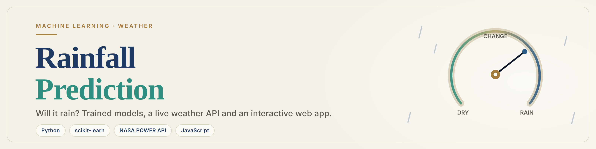
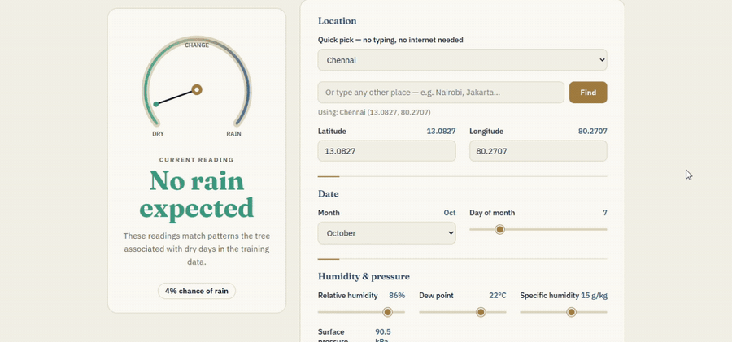
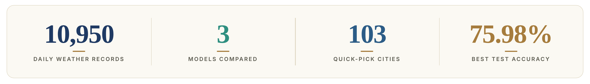
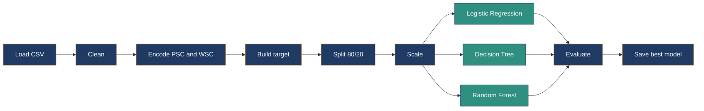
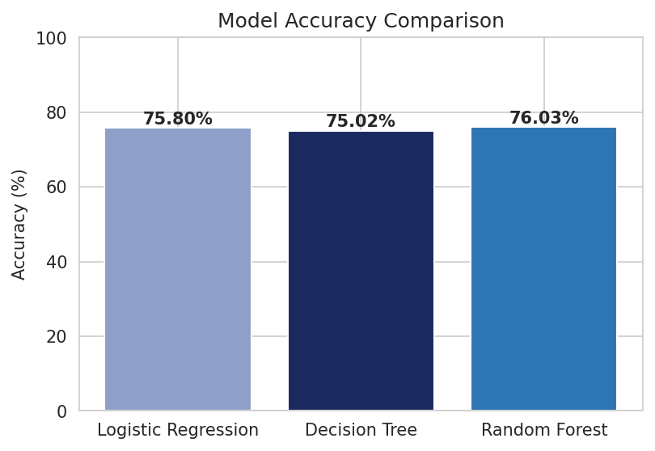
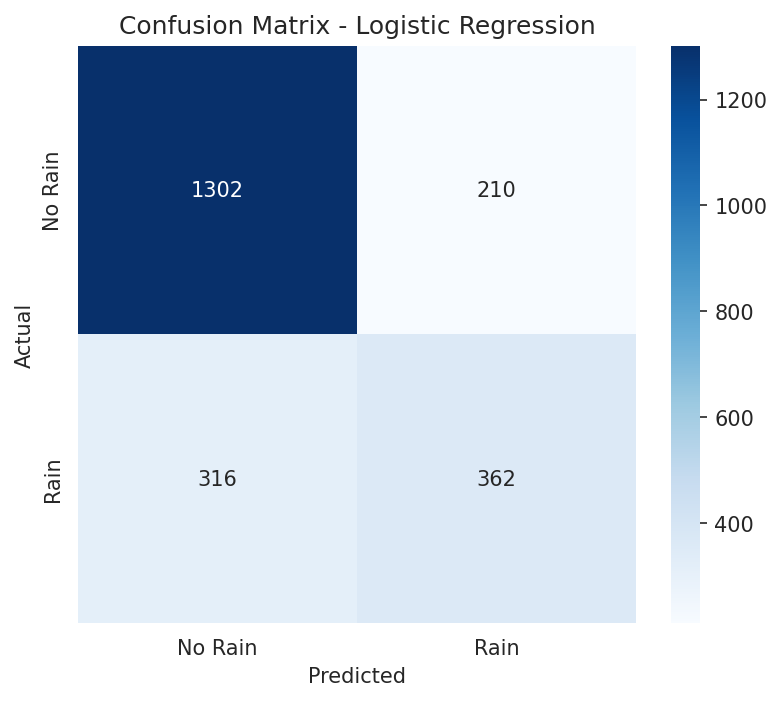
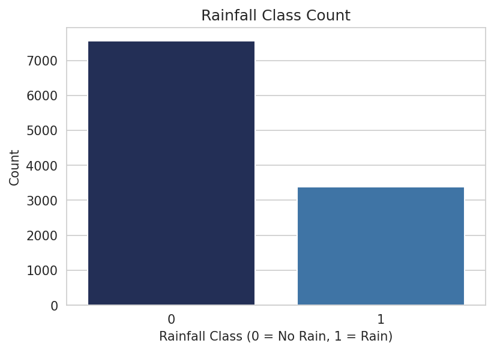

<p align="center">
  
</p>

<h3 align="center">Enter the weather. Watch the dial. Know if it will rain.</h3>

<p align="center">
  
  
  
  
</p>

<p align="center">
  <a href="#-web-app"><b>Web App</b></a> &nbsp;·&nbsp;
  <a href="#-models-and-results"><b>Results</b></a> &nbsp;·&nbsp;
  <a href="#-getting-started"><b>Get Started</b></a> &nbsp;·&nbsp;
  <a href="#-live-weather-api"><b>Live API</b></a> &nbsp;·&nbsp;
  <a href="#-limitations"><b>Limitations</b></a>
</p>

<p align="center">
  
</p>

<p align="center">
  
</p>

<p align="center"></p>

## 🌧️ Overview

A machine learning project that predicts whether it will **rain or not** from daily weather readings: humidity, temperature, pressure, wind, UV index and location.

<table>
  <tr>
    <td width="33%" valign="top">
      <h4>📓 Notebook</h4>
      Cleans the data, explores it, trains three models and compares them.
    </td>
    <td width="33%" valign="top">
      <h4>🛰️ Live API scripts</h4>
      Fetch real weather from NASA POWER and predict rain for any place.
    </td>
    <td width="33%" valign="top">
      <h4>🧭 Web app</h4>
      Pick a city, set the readings and see the prediction on a live dial.
    </td>
  </tr>
</table>

<p align="center"></p>

## ✨ Features

<table>
  <tr>
    <td width="33%" valign="top">
      <b>🎯 Rain or no rain</b><br>
      Binary classification on <code>Rainfall_Class</code>.
    </td>
    <td width="33%" valign="top">
      <b>🤖 Three models</b><br>
      Logistic Regression, Decision Tree and Random Forest, compared side by side.
    </td>
    <td width="33%" valign="top">
      <b>🌍 Any place on Earth</b><br>
      Location is latitude and longitude, not a fixed list of districts.
    </td>
  </tr>
  <tr>
    <td valign="top">
      <b>🛰️ Live weather</b><br>
      Real data from the free NASA POWER API. No key needed.
    </td>
    <td valign="top">
      <b>🧭 Barometer dial</b><br>
      100+ quick-pick cities and full control of every reading.
    </td>
    <td valign="top">
      <b>⚡ Runs in the browser</b><br>
      No server and no Python needed for the web app.
    </td>
  </tr>
</table>

<p align="center"></p>

## 🧭 Web app

Open `app/index.html` in any browser (double-click it). The result card stays in view while you change the readings.

**Choose a location, three ways**

| | Method | Needs internet? |
|---|--------|-----------------|
| 1 | **Quick pick:** 100+ cities (every Indian state and union territory, plus major cities worldwide) | No |
| 2 | **Search by name:** type any place and click **Find** (Open-Meteo geocoding) | Yes |
| 3 | **Coordinates:** type latitude and longitude by hand | No |

> [!TIP]
> Set **Relative humidity** to about 85% and the month to June through September. The dial swings to **Rain likely**. In January the same humidity gives **No rain expected**.

**How it works:** a Decision Tree (depth 6) was trained on the project dataset in scikit-learn. Its decision rules were exported as a JavaScript function inside `app/index.html`, so the prediction runs locally in your browser.

<details>
<summary><b>🌐 Host it free with GitHub Pages</b></summary>
<br>

After pushing, go to **Settings > Pages**, choose **Deploy from a branch**, pick `main` and the `/ (root)` folder, then open:

`https://YOUR-USERNAME.github.io/Rainfall-Prediction-ML/app/`

</details>

<p align="center"></p>

## 🗂️ Project structure

```
Rainfall-Prediction-ML/
├── assets/
│   ├── banner.png                    # README banner
│   ├── divider.svg                   # section divider
│   ├── stats.png                     # stats strip
│   └── rainfall-demo.gif             # web app demo
├── api/
│   ├── common_features.py            # shared feature logic and column order
│   ├── fetch_power_data.py           # download real historical weather (NASA POWER)
│   ├── predict_live.py               # predict rain for any latitude/longitude
│   └── requirements.txt
├── app/
│   └── index.html                    # interactive web app (single file)
├── dataset/
│   ├── make_dataset.py               # generates the dataset
│   └── rainfall_dataset.csv          # 10,950 rows x 20 columns
├── graphs/                           # EDA and evaluation charts
├── models/                           # saved model, scaler and encoders (.pkl)
├── notebooks/
│   ├── Rainfall_Prediction.ipynb     # main notebook, already run with outputs
│   └── rainfall_prediction.py        # same pipeline as a plain script
├── .gitignore
└── README.md
```

<p align="center"></p>

## 📊 Dataset

`dataset/rainfall_dataset.csv` has **10,950 daily records** from **5 Karnataka districts** (Bengaluru Urban, Chikkaballapur, Kolar, Ramanagara, Tumakuru) over **2020 to 2025**. About **31%** of days are rainy.

> [!NOTE]
> The included CSV is **generated** by `dataset/make_dataset.py`. It uses the real NASA POWER column format and realistic seasonal patterns (wet monsoon, dry summer), but it is **not measured weather data**. To use real data, see [Live weather API](#-live-weather-api).

<details>
<summary><b>📋 Column reference</b></summary>
<br>

| Group | Columns |
|-------|---------|
| Date | `YEAR`, `MO`, `DY` |
| Location | `DISTRICT`, `LATITUDE`, `LONGITUDE` |
| Humidity | `RH2M` relative humidity (%), `QV2M` specific humidity, `T2MDEW` dew point |
| Temperature | `T2M_MAX`, `T2M_MIN`, `T2MWET` wet bulb, `TS` surface temperature |
| Pressure and wind | `PS` surface pressure, `WS50M` wind speed, `WD50M` wind direction, `PSC` pressure category, `WSC` wind category |
| Sun | `ALLSKY_SFC_UV_INDEX` |
| Rainfall | `PRECTOTCORR` corrected precipitation (mm) |

</details>

<p align="center"></p>

## 🔄 Pipeline



<details>
<summary><b>🔍 The 10 steps in detail</b></summary>
<br>

1. **Data collection:** load the CSV.
2. **Cleaning:** check for missing values.
3. **Encoding:** label-encode the pressure category (`PSC`) and wind category (`WSC`).
4. **Target:** `Rainfall_Class = 1` if `PRECTOTCORR > 0`, else `0`.
5. **Features:** 18 columns in a fixed order. `PRECTOTCORR` is dropped because the target is built from it (data leakage). The district name is dropped and latitude/longitude are used instead.
6. **Split:** 80% train and 20% test, stratified, `random_state=42`.
7. **Scaling:** `StandardScaler`, fitted on the training data only.
8. **Training:** Logistic Regression, Decision Tree (`max_depth=8`), Random Forest (`n_estimators=100`).
9. **Evaluation:** accuracy, classification report and confusion matrix.
10. **Saving:** the best model, scaler and encoders go into `models/`.

</details>

<p align="center"></p>

## 🏆 Models and results

Results on the 2,190-row test set:

| Model | Accuracy |
|-------|----------|
| 🥇 **Logistic Regression** | **75.98%** |
| 🥈 Random Forest | 75.71% |
| 🥉 Decision Tree | 75.07% |

<details>
<summary><b>📈 Classification report (Logistic Regression)</b></summary>
<br>

| Class | Precision | Recall | F1-score | Support |
|-------|-----------|--------|----------|---------|
| No Rain | 0.80 | 0.86 | 0.83 | 1512 |
| Rain | 0.63 | 0.53 | 0.58 | 678 |
| **Accuracy** | | | **0.76** | 2190 |

</details>

<p align="center">
  
  
  
</p>

The three models score within one percentage point of each other, so the data and features limit accuracy more than the choice of model. Relative humidity (`RH2M`) is the strongest signal. In the saved Logistic Regression model it counts for more than four times as much as any other feature.

<p align="center"></p>

## 🚀 Getting started

**1. Clone the repository**

```bash
git clone https://github.com/YOUR-USERNAME/Rainfall-Prediction-ML.git
cd Rainfall-Prediction-ML
```

**2. Install the libraries**

```bash
pip install pandas numpy matplotlib seaborn scikit-learn requests
```

**3. Run the notebook**

Open `notebooks/Rainfall_Prediction.ipynb` in VS Code or Jupyter and choose **Run All**. Or run the script from inside the `notebooks` folder:

```bash
cd notebooks
python rainfall_prediction.py
```

> [!IMPORTANT]
> The notebook uses relative paths, so run it from the `notebooks` folder.

**4. Open the web app**

Double-click `app/index.html`.

<p align="center"></p>

## 🛰️ Live weather API

The scripts in `api/` use **[NASA POWER](https://power.larc.nasa.gov/)**, a free weather and climate API that needs no key. They need an internet connection.

**Predict rain now for any place**

```bash
cd api
python predict_live.py --lat 13.0827 --lon 80.2707 --place "Chennai"
```

Example output:

```
Prediction for Chennai on 20261001: NO RAIN
Confidence: No Rain: 72.6%  |  Rain: 27.4%
```

NASA POWER publishes the newest days with a delay. The script searches the last 45 days (change it with `--lookback`) and uses the latest day with usable data. It rejects impossible values, such as a wind direction outside 0 to 360 degrees, and replaces any missing field with a typical value.

<details>
<summary><b>⬇️ Download real historical data</b></summary>
<br>

```bash
cd api
python fetch_power_data.py --lat 12.9716 --lon 77.5946 --district "Bengaluru Urban" \
    --start 20200101 --end 20251231 --out ../dataset/rainfall_dataset_real.csv
```

`--district` is only a label stored in the CSV. To train on real data, collect a CSV for each place you want, combine them, save the result as `dataset/rainfall_dataset.csv` (or change the path in the notebook) and re-run the notebook.

</details>

<p align="center"></p>

## ⚠️ Limitations

> [!WARNING]
> **The included dataset is generated, not measured.** Accuracy of about 76% describes the model on this generated data. It is not a claim about real-world forecasting.

- **Real weather can look different from the training data.** For example, real surface pressure in Bengaluru is about 92 kPa, but the generated data sits between 95.8 and 97 kPa. The pressure category thresholds in `api/common_features.py` were set for the generated data, so recompute them if you train on real data.
- **Location has almost no effect on the result.** In the training data, rain depends mainly on humidity and season, not on which place it is. Two cities with the same readings get the same answer.
- **The model sees one day at a time.** It does not use yesterday's weather or satellite and radar data, so it is not a replacement for a real forecast.
- **The saved model needs a compatible scikit-learn.** A `scikit-learn` version warning when loading the `.pkl` files is harmless. Re-run the notebook to rebuild them on your version.

<p align="center"></p>

## 🔭 Future scope

- [ ] Train on real multi-year NASA POWER data for many locations
- [ ] Use previous days as features, and try XGBoost, LightGBM or an LSTM
- [ ] Add cloud cover, solar radiation and air quality features
- [ ] Add a "Get today's weather" button in the web app that fills the readings automatically
- [ ] Predict rainfall amount (regression) as well as rain or no rain
- [ ] Rainfall alerts and a mobile-friendly installable app

<p align="center"></p>

## 🧰 Tech stack

<p align="center">
  
  
  
  
  
  
  
  
  
  
</p>

<p align="center"></p>

## 👩‍💻 About

Built by **Harika Podalakuru** (B.Tech, Artificial Intelligence and Machine Learning, Madanapalle Institute of Technology and Science) during an internship at **Zephyr Technologies and Solutions Pvt Ltd**, Bengaluru.

Weather data format and live data: [NASA POWER](https://power.larc.nasa.gov/). Place-name lookup: [Open-Meteo](https://open-meteo.com/).

<br>

<p align="center">
  <br><br>
  <b>If this project helped you, please give it a ⭐</b><br>
  <sub>Made with care, curiosity and a lot of weather data.</sub>
</p>
